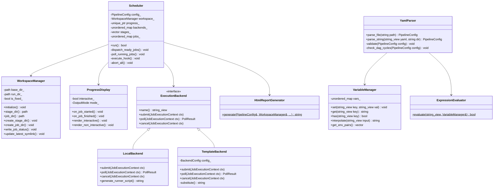

# C++20 Subsystem Architecture {#dev_architecture}

The Condor codebase is built with Modern C++ (C++20), organized into modular, loosely-coupled subsystems located in `include/condor/` and `src/`.

---

## 1. Class Architecture Overview

---

## 2. Core Subsystems

### Subsystem 1: Scheduler & State Machine (`include/condor/scheduler.hpp`, `src/scheduler.cpp`)
The central execution engine:
- **`Scheduler`**: Manages the life cycle of the pipeline. Runs a non-blocking poll loop (`poll_running_jobs`), checks dependency readiness (`is_stage_ready`, `is_job_ready`), dispatches runnable jobs (`dispatch_ready_jobs`), and synchronizes the stage manifest (`stage_manifest.txt`).
- **`StageRuntimeState` & `JobRuntimeState`**: Track status (`QUEUED`, `RUNNING`, `PASSED`, `FAILED`, `SKIPPED`, `ABORTED`), process IDs, elapsed durations, exit codes, and owning backend instances.
- **`RuntimeMenu` (`src/menu.cpp`)**: Manages non-blocking terminal `stdin` polling, capturing keystrokes (`p`, `r`, `k`, `q`) to pause or abort scheduling without stopping active child processes.

### Subsystem 2: Configuration & AST Parser (`include/condor/parser.hpp`, `src/parser.cpp`)
Responsible for reading, expanding, and validating pipeline definitions:
- **`YamlParser`**: Parses pipeline YAML files using `yaml-cpp`. Expands test matrices (`count: N`), expands multi-seed sweeps (`seeds: [...]`), applies hierarchical two-tier defaults (`defaults:`), and merges external modular files (`include:`).
- **Validation & DAG Cycle Detection**: Verifies that all stage and variable names conform to POSIX identifier rules (`^[a-zA-Z0-9_-]+$`). Runs depth-first search (DFS) with a recursion stack to detect cyclic stage dependencies before execution starts.
- **`ExpressionEvaluator` (`src/expression.cpp`)**: Recursive-descent expression evaluator for `enabled_if` conditions. Evaluates equality, inequalities (`<`, `<=`, `>`, `>=`), negation (`!`), and boolean logic (`&&`, `||`).

### Subsystem 3: Variable Resolution & Interpolation (`include/condor/variable.hpp`, `src/variable.cpp`)
- **`VariableManager`**: Thread-safe storage for user-defined and built-in variables. Provides fast `${VAR}` and `$VAR` string interpolation with fallback defaults (`${VAR:-default}`). Exports variables formatted as environment pairs (`CONDOR_VAR_<UPPER_KEY>=<VAL>`).

### Subsystem 4: Filesystem & Workspace Engine (`include/condor/workspace.hpp`, `src/workspace.cpp`)
- **`WorkspaceManager`**: Manages timestamped run folders (`YYYYMMDD_HHMMSS_<rand>`) in `condor_runs/` or explicit `--run-dir` directories. Maintains an atomic symlink `condor_runs/latest` via temp symlink swapping (`rename`). Writes human-readable `stage_manifest.txt`, legacy `job_status.txt`, and structured `job_status.yaml` records.

### Subsystem 5: Execution Backends (`include/condor/backend.hpp`, `src/backend.cpp`)
- **`ExecutionBackend`**: Abstract interface defining `submit`, `poll`, and `cancel`.
- **`LocalBackend`**: Fork/exec implementation with `setpgid` process group isolation, working directory change, stdout/stderr redirection to log files, and runner script generation (`generate_runner_script`).
- **`TemplateBackend`**: Custom cluster backend implementing string template substitution for job submission, polling, and cancellation commands (`sbatch`, `qstat`, `scancel`).
- **`BackendFactory`**: Creates concrete backend instances from YAML definitions.

### Subsystem 6: Progress & Interactive Reporting (`src/progress.cpp`, `src/html_report.cpp`)
- **`ProgressDisplay`**: Queries terminal column dimensions dynamically via `ioctl(STDOUT_FILENO, TIOCGWINSZ, &ws)`. Renders multi-track progress bars with ANSI color escapes. Supports non-interactive periodic CI logging and output filtering (`all`, `failures`, `summary`).
- **`HtmlReportGenerator`**: Compiles the zero-dependency interactive `report.html` report with embedded CSS, JavaScript, stage navigation bars, custom machine metrics extraction, and embedded log viewers.
