# C++20 Subsystem Architecture {#dev_architecture}

**Condor** (**Con**current + **D**ependency + **Or**chestrator) is built with Modern C++ (C++20), organized into modular, loosely-coupled subsystems located in `include/condor/` and `src/`.

---

## 1. Class Architecture Overview

```mermaid
classDiagram
    class Scheduler {
        -PipelineConfig config_
        -WorkspaceManager workspace_
        -unique_ptr progress_
        -unordered_map backends_
        -vector stages_
        -unordered_map jobs_
        +run() bool
        -dispatch_ready_jobs() void
        -poll_running_jobs() void
        -execute_hook() void
        -abort_all() void
    }

    class ExecutionBackend {
        <<interface>>
        +name() string_view
        +submit(JobExecutionContext ctx)
        +poll(JobExecutionContext ctx) PollResult
        +cancel(JobExecutionContext ctx)
    }

    class LocalBackend {
        +submit(JobExecutionContext ctx)
        +poll(JobExecutionContext ctx) PollResult
        +cancel(JobExecutionContext ctx)
        +generate_runner_script() string
    }

    class TemplateBackend {
        -BackendConfig config_
        +submit(JobExecutionContext ctx)
        +poll(JobExecutionContext ctx) PollResult
        +cancel(JobExecutionContext ctx)
        -substitute() string
    }

    class WorkspaceManager {
        -path base_dir_
        -path run_dir_
        -bool is_fixed_
        +initialize() void
        +stage_dir() path
        +job_dir() path
        +create_stage_dir() void
        +create_job_dir() void
        +write_job_status() void
        +update_latest_symlink() void
    }

    class YamlParser {
        +parse_file(string path) PipelineConfig
        +parse_string(string_view yaml, string dir) PipelineConfig
        -validate(PipelineConfig config) void
        -check_dag_cycles(PipelineConfig config) void
    }

    class VariableManager {
        -unordered_map vars_
        +set(string_view key, string_view val) void
        +get(string_view key) string
        +has(string_view key) bool
        +interpolate(string_view input) string
        +get_env_pairs() vector
    }

    class ExpressionEvaluator {
        +evaluate(string_view, VariableManager&) bool$
    }

    class ProgressDisplay {
        -bool interactive_
        -OutputMode mode_
        +on_job_started() void
        +on_job_finished() void
        +render_interactive() void
        +render_non_interactive() void
    }

    class HtmlReportGenerator {
        +generate(PipelineConfig&, WorkspaceManager&, ...) string$
    }

    class RemoteServerClient {
        -ServerConfig config_
        -atomic_bool running_
        -atomic_bool connected_
        +start() void
        +stop() void
        +send_telemetry(json) void
        +send_event(string, json) void
        +set_command_handler(cb) void
    }

    class HubServer {
        -HubConfig config_
        -FleetManager fleet_manager_
        -atomic_bool running_
        +start() bool
        +stop() void
        -event_loop() void
        -handle_socket_read() void
    }

    ExecutionBackend <|-- LocalBackend
    ExecutionBackend <|-- TemplateBackend
    Scheduler --> WorkspaceManager
    Scheduler --> ProgressDisplay
    Scheduler --> ExecutionBackend
    Scheduler --> HtmlReportGenerator
    Scheduler --> RemoteServerClient
    HubServer --> FleetManager
    YamlParser --> VariableManager
    YamlParser --> ExpressionEvaluator
```

---

## 2. Core Subsystems

### Subsystem 1: Scheduler & State Machine (include/condor/scheduler.hpp, src/scheduler.cpp)
The central execution engine:
- **`Scheduler`**: Manages the life cycle of the pipeline. Runs a non-blocking poll loop (`poll_running_jobs`), checks dependency readiness (`is_stage_ready`, `is_job_ready`), dispatches runnable jobs (`dispatch_ready_jobs`), and synchronizes the stage manifest (`stage_manifest.txt`).
- **`StageRuntimeState` & `JobRuntimeState`**: Track status (`QUEUED`, `RUNNING`, `PASSED`, `FAILED`, `SKIPPED`, `ABORTED`), process IDs, elapsed durations, exit codes, and owning backend instances.
- **`RuntimeMenu` (`src/menu.cpp`)**: Manages non-blocking terminal `stdin` polling, capturing keystrokes (`p`, `r`, `k`, `q`) to pause or abort scheduling without stopping active child processes.

### Subsystem 2: Configuration & AST Parser (include/condor/parser.hpp, src/parser.cpp)
Responsible for reading, expanding, and validating pipeline definitions:
- **`YamlParser`**: Parses pipeline YAML files using `yaml-cpp`. Expands test matrices (`matrix: {...}`), test replication (`count: N`), applies hierarchical defaults (`defaults:`), and merges external modular files (`include:`).
- **Validation & DAG Cycle Detection**: Verifies that all stage and variable names conform to POSIX identifier rules (`^[a-zA-Z0-9_-]+$`). Runs depth-first search (DFS) with a recursion stack to detect cyclic stage dependencies before execution starts.
- **`ExpressionEvaluator` (`src/expression.cpp`)**: Recursive-descent expression evaluator for `enabled_if` conditions. Evaluates equality, inequalities (`<`, `<=`, `>`, `>=`), negation (`!`), and boolean logic (`&&`, `||`).

### Subsystem 3: Variable Resolution & Interpolation (include/condor/variable.hpp, src/variable.cpp)
- **`VariableManager`**: Thread-safe storage for user-defined and built-in variables. Provides fast `${VAR}` and `$VAR` string interpolation with fallback defaults (`${VAR:-default}`). Exports variables formatted as environment pairs (`CONDOR_VAR_<UPPER_KEY>=<VAL>`).

### Subsystem 4: Filesystem & Workspace Engine (include/condor/workspace.hpp, src/workspace.cpp)
- **`WorkspaceManager`**: Manages timestamped run folders (`YYYYMMDD_HHMMSS_<rand>`) in `condor_runs/` or explicit `--run-dir` directories, enforcing a clean directory layout (`artifacts/` for HTML/JUnit reports, `pipeline/` for operational logs and summaries, and `stages/` for workload execution). Maintains an atomic symlink `condor_runs/latest` via temp symlink swapping (`rename`). Writes human-readable `stage_manifest.txt`, plain-text `job_status.txt`, and structured `job_status.yaml` records.

### Subsystem 5: Execution Backends (include/condor/backend.hpp, src/backend.cpp)
- **`ExecutionBackend`**: Abstract interface defining `submit`, `poll`, and `cancel`.
- **`LocalBackend`**: Fork/exec implementation with `setpgid` process group isolation, working directory change, stdout/stderr redirection to log files, and runner script generation (`generate_runner_script`).
- **`TemplateBackend`**: Custom cluster backend implementing string template substitution for job submission, polling, and cancellation commands (`sbatch`, `qstat`, `scancel`).
- **`BackendFactory`**: Creates concrete backend instances from YAML definitions.

### Subsystem 6: Progress & Interactive Reporting (src/progress.cpp, src/html_report.cpp)
- **`ProgressDisplay`**: Queries terminal column dimensions dynamically via `ioctl(STDOUT_FILENO, TIOCGWINSZ, &ws)`. Renders multi-track progress bars with ANSI color escapes. Supports non-interactive periodic CI logging and output filtering (`all`, `failures`, `summary`).
- **`HtmlReportGenerator`**: Compiles the zero-dependency interactive `artifacts/report.html` report with embedded CSS, JavaScript, stage navigation bars, custom machine metrics extraction, and embedded log viewers.

### Subsystem 7: Remote Client Engine (include/condor/remote_client.hpp, src/remote_client.cpp)
- **`RemoteServerClient`**: Thread-safe asynchronous client communicating with a central reporting server over WebSocket (RFC 6455) or HTTP POST fallback. Operates a background worker thread with a thread-safe outbound message queue (`outbound_queue_`).
- **Bidirectional Event & Command Dispatch**: Dispatches events (`pipeline_started`, `job_started`, `job_finished`, `pipeline_aborted`, `pipeline_finished`) and streams real-time telemetry frames. Listens for incoming remote commands (`pause`, `resume`, `abort`, `kill_job`, `scale_slots`) and delegates them to the `Scheduler` via callbacks.
- **Offline Invariant**: Completely disabled unless explicitly configured in YAML (`settings.server.enabled: true`) or CLI (`--server-url`). When disabled, no worker thread is created and no network operations are performed.

### Subsystem 8: Condor Hub Server (server/include/hub/, server/src/)
- **`HubServer` (`server/include/hub/server.hpp`, `server/src/server.cpp`)**: Asynchronous socket server utilizing Linux `epoll` and `eventfd` wakeup. Manages non-blocking TCP sockets, HTTP requests, and WebSocket handshakes (`compute_websocket_accept` in `crypto.hpp`).
- **`FleetManager` (`server/include/hub/fleet_manager.hpp`, `server/src/fleet_manager.cpp`)**: Thread-safe registry and state machine tracking active and completed pipeline runs (`RunRecord`), active jobs (`ActiveJobRecord`), stage progression, and connected dashboard WebSocket clients.
- **Embedded Web Dashboard (`server/include/hub/dashboard_html.hpp`)**: Single-page dark-mode dashboard served from memory with zero asset file dependencies. Visualizes live fleet metrics, active worker PIDs, and provides interactive control buttons.
