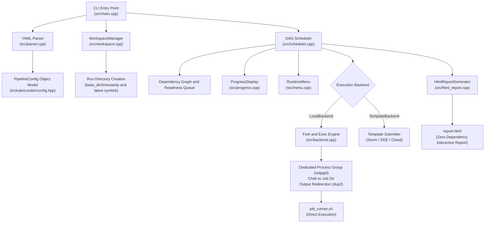
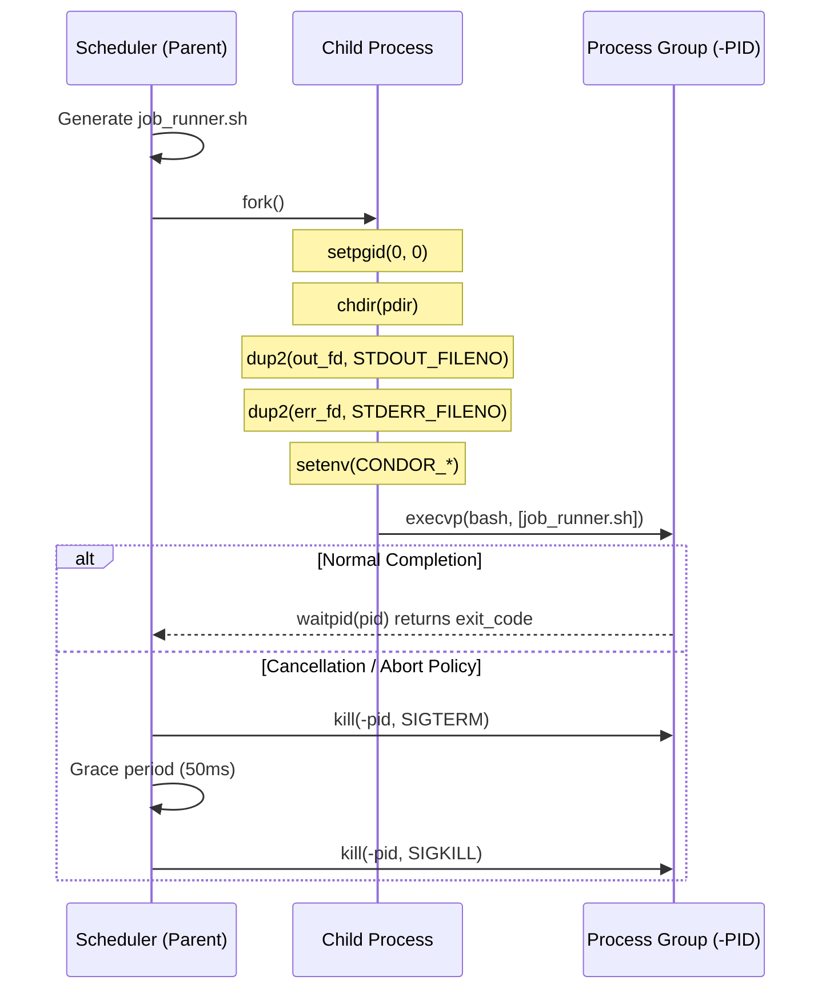

# System Architecture & Execution Engine {#user_architecture}

This document provides a detailed technical overview of Condor's execution model, DAG scheduling mechanics, POSIX process group isolation, and filesystem architecture.

> **Name Origin**: **Condor** represents the synergy of three foundational architectural pillars:
> - **Con**current &mdash; High-throughput POSIX process parallelism and asynchronous distributed grid execution.
> - **D**ependency &mdash; Graph-based directed acyclic graph (DAG) topological scheduling with dynamic cycle detection.
> - **Or**chestrator &mdash; Resilient pipeline orchestration with unified defaults, lifecycle hooks, failure recovery, and zero external runtime dependencies.

---

## 1. High-Level Architecture



---

## 2. Directed Acyclic Graph (DAG) Scheduler

Condor models execution workflows as directed acyclic graphs across two levels:
1. **Stage-Level DAG**: Evaluates dependencies specified in `depends_on: [stage_a, stage_b]`.
2. **Job-Level Dependencies**: Resolves cross-stage or intra-stage job dependencies (`depends_on: ["build/0001"]`).

### Readiness & Dispatch Cycle
The scheduler operates a non-blocking event loop:
1. **Dependency Evaluation**: A stage becomes `RUNNING` only when all of its declared prerequisite stages have reached terminal `PASSED` or `SKIPPED` states.
2. **Job Readiness**: Queued jobs within active stages are evaluated. A job is marked ready when its dependencies have succeeded.
3. **Concurrency Limiting**: Ready jobs are dispatched to available worker slots up to `max_parallel_jobs` (defaulting to `std::thread::hardware_concurrency()`).
4. **Non-Blocking Polling**: Running jobs are polled using non-blocking system calls (`waitpid(pid, &status, WNOHANG)` for local jobs, or custom poll commands for grid backends).

---

## 3. Strict POSIX Process Isolation

To prevent stray child processes, orphaned daemons, or workspace cross-contamination:



1. **Dedicated Process Groups (`setpgid`)**:
   Immediately following `fork()`, the child process executes `setpgid(0, 0)`, establishing an independent process group.
2. **Clean Cancellation (`kill(-pid, ...)` )**:
   When aborting or cancelling a job, Condor sends signals to `-pid` (the entire process group). Any subprocesses spawned by the test command (such as child compilers, simulators, or Python workers) are reliably terminated without leaking.
3. **Directory Isolation**:
   The child executes `chdir()` into its dedicated job directory before redirecting stdout/stderr to `stdout.log` and `stderr.err`.

---

## 4. Standalone Runner Script (job_runner.sh)

Rather than executing opaque shell strings or dynamic string `eval`, Condor writes a self-contained, POSIX-compliant runner script inside every job folder prior to execution:

```bash
#!/usr/bin/env bash
# ==============================================================================
# Condor Generated Job Runner Script
# Stage:         sim_tests
# Job ID:        0001
# Job Name:      arithmetic
#
# Reproduce this job standalone:
#   cd "/path/to/condor_runs/.../sim_tests/0001"
#   ./job_runner.sh
# ==============================================================================
set -o pipefail

export CONDOR_RUN_DIR="../.."
export CONDOR_STAGE_DIR=".."
export CONDOR_JOB_DIR="."
export BUILD_DIR="../../build_rtl/0001"
export TEST_DIR="."

cd "$CONDOR_JOB_DIR" || exit 1

# Execute command directly
echo "[CONDOR RUNNER] Executing command:"
echo "  ./bin/alu_sim --test=arithmetic"
./bin/alu_sim --test=arithmetic
exit $?
```

This architecture ensures that any verification failure can be reproduced instantly by an engineer navigating directly into the job directory and running `./job_runner.sh` without invoking the main scheduler.

---

## 5. Artifact Hand-offs (${BUILD_DIR} and ${TEST_DIR})

Condor automates artifact passing between compilation and testing stages:
- **Build Stage Discovery**: When a stage depends on a build stage (any stage containing `"build"` in its name or the first declared dependency), the scheduler discovers the build job directory and injects its path as `${BUILD_DIR}` and `${CONDOR_BUILD_DIR}` into dependent test jobs.
- **Relative Path Resolution**: When `path_style: relative` is configured, Condor computes relative filesystem paths (`../../build_rtl/0001`), ensuring that build artifacts can be referenced portably without hardcoded absolute paths.
