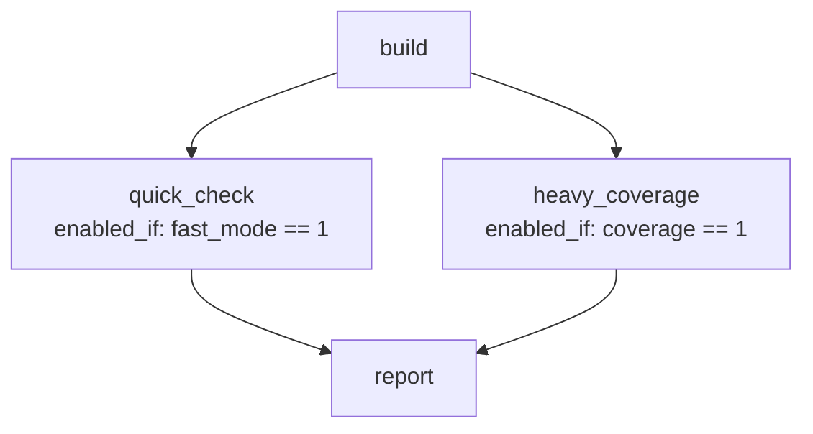

# Examples Catalog {#examples_catalog}

The repository bundles a curated, minimal complete set of **6 self-contained examples** located in [`examples/`](file:///home/eze/projects/github/condor/examples/). Every example adheres to the exact same uniform directory layout, placing its pipeline configuration inside a dedicated `scripts/` directory alongside all necessary execution scripts and included test suites.

@note All examples assume `condor` is in your system `PATH` (e.g. via `sudo make install` or by exporting its installation directory into `PATH`). Invoke `condor` directly without any build directory prefix.

```text
examples/<example_name>/
└── scripts/
    ├── pipeline.yaml         # Pipeline configuration inside scripts/
    └── [runner scripts & modular test suite YAMLs]
```

---

## Minimal Complete Set Summary

| Example | Directory | Focus & Configurations Covered | Make Target |
| :--- | :--- | :--- | :--- |
| **1. Simple** | [`examples/simple/`](file:///home/eze/projects/github/condor/examples/simple/) | Linear DAG (`build -> test -> package`), stage-level DAG dependencies, global & stage variables, status interval. | `make run-simple` |
| **2. Conditional DAG** | [`examples/conditional/`](file:///home/eze/projects/github/condor/examples/conditional/) | Diamond/branching DAG, stage & job-level `enabled_if` conditionals (`==`, `!=`, comparisons), skipped stage dependency satisfaction. | `make run-conditional`<br>`make run-coverage` |
| **3. Matrix & Includes** | [`examples/matrix_and_includes/`](file:///home/eze/projects/github/condor/examples/matrix_and_includes/) | `path_style: relative`, global `defaults:`, test scaling (`count: 4`), multi-seed sweeps (`seeds: [...]`), modular test suite `include: "test_suite.yaml"`. | `make run-matrix` |
| **4. Failure Policies** | [`examples/failure_policies/`](file:///home/eze/projects/github/condor/examples/failure_policies/) | `on_failure_action: continue`, `exit_zero_on_failure: true`, `allow_failure: true` on stages & jobs, lifecycle hooks with `always: true`, `output_mode: failures`. | `make run-failures` |
| **5. Custom Backends** | [`examples/custom_backends/`](file:///home/eze/projects/github/condor/examples/custom_backends/) | Custom template backends (`type: template` simulating Slurm/SGE/cloud), `{script}`, `{grid_id}`, `{job_id}`, pipeline backend configuration (`settings.backend: grid_cluster`), job-level dependencies (`depends_on: ["prepare/0002"]`). | `make run-backends` |
| **6. EDA Verification** | [`examples/verilator/`](file:///home/eze/projects/github/condor/examples/verilator/) | Real-world EDA hardware verification pipeline, SystemVerilog RTL, cycle-accurate simulation, 10 test suites, conditional coverage collection/merging, unified reports. | `make run-verilator`<br>`make run-verilator-coverage` |

---

## 1. Simple Pipeline (examples/simple/)

Demonstrates standard build, test, and packaging workflows using explicit job definitions and DAG dependencies:

- **Pipeline File**: [`examples/simple/scripts/pipeline.yaml`](file:///home/eze/projects/github/condor/examples/simple/scripts/pipeline.yaml)
- **Features Demonstrated**: Linear DAG, job-level commands, environment variable hand-offs (`${BUILD_DIR}` to `${TEST_DIR}`).

```bash
# Execute via Makefile
make run-simple

# Or invoke directly with Condor binary:
condor examples/simple/scripts/pipeline.yaml
```

---

## 2. Conditional DAG (examples/conditional/)

Demonstrates dynamic pipeline routing with branching and converging DAG dependencies:



- **Pipeline File**: [`examples/conditional/scripts/pipeline.yaml`](file:///home/eze/projects/github/condor/examples/conditional/scripts/pipeline.yaml)
- **Features Demonstrated**: Diamond DAG, `enabled_if` conditions, skipped stage DAG satisfaction.

```bash
# Run default (fast_mode=1, coverage=0 -> heavy_coverage skipped, report runs)
make run-conditional

# Run with coverage enabled (coverage=1 -> both branches execute)
make run-coverage
```

---

## 3. Matrix Scaling & Includes (examples/matrix_and_includes/)

Demonstrates massive test scaling, parameter sweeps, and modular YAML inclusion:

- **Pipeline File**: [`examples/matrix_and_includes/scripts/pipeline.yaml`](file:///home/eze/projects/github/condor/examples/matrix_and_includes/scripts/pipeline.yaml)
- **Included Suite**: [`examples/matrix_and_includes/scripts/test_suite.yaml`](file:///home/eze/projects/github/condor/examples/matrix_and_includes/scripts/test_suite.yaml)
- **Features Demonstrated**:
  - `path_style: relative` (all working paths are clean relative paths `.` and `../..`)
  - Global `defaults:` block defining command templates
  - Stage-level `defaults:` merging
  - `count: 4` (dispatches 4 parallel stress instances)
  - `seeds: [101, 202, 303, 404]` (sweeps 4 random seeds)
  - Custom machine metrics generation (`test_metric.yaml`)

```bash
make run-matrix
```

---

## 4. Failure Policies & Error Handling (examples/failure_policies/)

Demonstrates enterprise fault tolerance and graceful error recovery:

- **Pipeline File**: [`examples/failure_policies/scripts/pipeline.yaml`](file:///home/eze/projects/github/condor/examples/failure_policies/scripts/pipeline.yaml)
- **Features Demonstrated**:
  - `on_failure_action: continue` (unrelated branches continue executing even when a critical test fails)
  - `exit_zero_on_failure: true` (forces zero return code for CI report archiving)
  - `allow_failure: true` (allows experimental tests to fail without marking stage as failed)
  - Stage hooks with `always: true` (post-stage cleanup script runs unconditionally)
  - `output_mode: failures` (suppresses noise and isolates failing test logs)

```bash
make run-failures
```

---

## 5. Custom Grid Backends (examples/custom_backends/)

Demonstrates delegating compute jobs to external grid clusters (Slurm, Grid Engine Family, IBM Spectrum LSF, PBS Professional & TORQUE, Apache Spark, or custom runners):

- **Pipeline File**: [`examples/custom_backends/scripts/pipeline.yaml`](file:///home/eze/projects/github/condor/examples/custom_backends/scripts/pipeline.yaml)
- **Features Demonstrated**:
  - `backends:` block defining template commands (`submit_command`, `poll_command`, `cancel_command`)
  - Template parameter interpolation (`{script}`, `{grid_id}`, `${CONDOR_PIPELINE_DIR}`)
  - Pipeline execution backend selection (`settings.backend: grid_cluster`)
  - Job-level cross-stage dependency (`depends_on: ["prepare/0002"]`)

```bash
make run-backends
```

---

## 6. EDA Hardware Verification Flow (examples/verilator/)

A production-grade EDA pipeline testing a 32-bit SystemVerilog Arithmetic Logic Unit (ALU):

- **Pipeline File**: [`examples/verilator/scripts/pipeline.yaml`](file:///home/eze/projects/github/condor/examples/verilator/scripts/pipeline.yaml)
- **RTL Source**: [`examples/verilator/rtl/alu.sv`](file:///home/eze/projects/github/condor/examples/verilator/rtl/alu.sv)
- **Testbench**: [`examples/verilator/tb/tb_alu.cpp`](file:///home/eze/projects/github/condor/examples/verilator/tb/tb_alu.cpp)
- **Test Suites**: [`examples/verilator/scripts/alu_tests.yaml`](file:///home/eze/projects/github/condor/examples/verilator/scripts/alu_tests.yaml) (10 suites: `arithmetic`, `logic`, `shift`, `mult`, `overflow`, `zero_flag`, `boundary`, `fuzz` across 3 seeds, `comparison`, `pipeline_stress`)
- **Features Demonstrated**:
  - Full RTL linting and cycle-accurate simulation compilation
  - Parallel execution across worker slots verifying millions of assertions
  - Line coverage measurement and database merging via EDA coverage analysis tools
  - Automated summary and terminal reports

```bash
# Standard verification run
make run-verilator

# Run with coverage collection and source annotation
make run-verilator-coverage

# Summary-only terminal output
make run-verilator OUTPUT_MODE=summary
```
