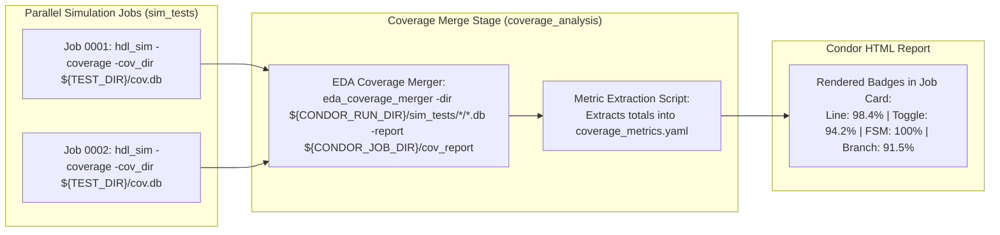

# Interactive HTML Execution Report {#html_report}

For every pipeline run, Condor automatically compiles a zero-dependency, self-contained interactive HTML report located at:

```text
<run_dir>/report.html
```

When timestamped run directories are generated in `./condor_runs/`, Condor automatically maintains an atomic symlink `./condor_runs/latest` pointing to the most recent run, allowing you to access the latest report via:

```bash
xdg-open ./condor_runs/latest/report.html
# Or on macOS:
open ./condor_runs/latest/report.html
```

---

## Zero-Dependency Offline Philosophy

The HTML report is fully self-contained within a single `.html` file:
- **No External CDN Dependencies**: All CSS styling, SVG icons, fonts, and JavaScript interactions are completely embedded inline.
- **Air-Gapped & Secure**: Opens and functions perfectly in completely offline environments without internet access.
- **Easy Archiving & Sharing**: Can be emailed, uploaded as a CI/CD build artifact, or hosted on internal static web servers without requiring server-side rendering or database backends.

---

## Key Report Features

### 1. Executive Summary & Metadata Header
The report header provides an immediate high-level overview of execution parameters:
- **Pipeline Name & Verdict**: Clear, prominent `Passed` or `Failed` status badge.
- **Execution Metadata**: Active run directory path, UTC timestamp, worker concurrency slots, and configured path style (`relative` or `absolute`).
- **Stats Grid**: Metric cards summarizing Total Jobs, Passed Jobs, Failed Jobs, and formatted pipeline duration (`HH:MM:SS` or milliseconds).

### 2. Stage Progression Visualizer
A dedicated multi-track progress section displays the status of every stage:
- **Interactive Clickable Bars**: Clicking any stage bar instantly scrolls down to that stage and filters the view to show only that stage's jobs.
- **Visual Color Coding**: Green (`fill-pass`) for completed stages, Red (`fill-fail`) for stages with errors, and Gray (`fill-skip`) for skipped stages.
- **Skipped Stage Reporting**: Stages skipped due to `enabled_if` conditions are accurately displayed as `1/1 skipped` with 100% skipped bars rather than confusing `0/1 passed` counters.

### 3. Per-Stage Navigation Bar & Deep-Linking
A sticky stage toolbar allows filtering the entire report by individual stages:
- **Stage Pills**: Click any stage button (`build_rtl`, `sim_tests`, etc.) to isolate its jobs.
- **Count Badges**: Each button displays the exact number of jobs contained within that stage.
- **Active Stage Banner**: When filtered, displays `Viewing Stage: <name>` with a one-click `✕ Show All Stages` reset button.
- **URL Hash Deep-Linking**: The report updates the browser address bar with anchor hashes (e.g., `report.html#stage=sim_tests`). Sharing or bookmarking this URL immediately restores the filtered stage view.

### 4. Search & Multi-Criteria Filtering
Locate specific jobs and failure logs instantly:
- **Real-Time Search Box**: As-you-type fuzzy substring filtering matching across job IDs (`#0001`), job names, stage names, and shell commands.
- **Status Filter Pills**: Toggle between `All`, `Passed`, `Failed`, and `Skipped` jobs.
- **Global Collapse / Expand**: One-click button to expand or collapse all job cards simultaneously.

### 5. Detailed Job Cards
Each job is rendered as an expandable card featuring:
- **Header Badges & Action Links**: Status pill (`PASSED`, `FAILED`, `SKIPPED`), job ID (`#0001`), stage name, job name, return exit code, execution time in seconds, and an **HTML Report Quick-Link** button if the job generated an HTML report.
- **Direct HTML Report Linking**: When a job or verification harness generates an HTML report (e.g. `cov_report/index.html`, `coverage.html`), Condor automatically detects it and renders a direct hyperlink button to view the report in a new tab without navigating folder hierarchies.
- **Command Box**: The exact command string that was executed.
- **Job Directory**: Working folder path (rendered as a relative path when `path_style: relative` is active).
- **Custom Machine Metrics Grid**: Automatically parses any `*.yaml` files written to the job folder into structured, formatted key-value cards (e.g. `assertions_verified: 200000`, `cycles_simulated: 100000`). If a metric value points to an `.html` file or URL, it is rendered as a clickable link.
- **Embedded Log Inspectors**: Dedicated syntax-highlighted viewers for:
  - Pre-Hook Output (`pre_hook.log`)
  - Standard Output (`stdout.log`)
  - Standard Error (`stderr.err`)
  - Post-Hook Output (`post_hook.log`)

### 6. Stage Lifecycle Hooks Section
For stages that define `pre` or `post` lifecycle hooks, the stage section includes an embedded, collapsible **Stage Lifecycle Hooks** panel displaying:
- `pre_hook.log` output viewer
- `post_hook.log` output viewer

---

## Tool-Agnostic Metric Ingestion Protocol

Condor is strictly **tool-agnostic**—the C++ core contains zero hardcoded parsers for specific compiler, synthesis, or simulator databases. Instead, it relies on an open, file-based metric ingestion contract.

### Metric Ingestion Architecture & Discovery
1. **File Scanning**: At the end of a pipeline execution, Condor's report generator inspects every job directory (`<run_dir>/<stage_name>/<job_id>/`).
2. **YAML Ingestion**: Any regular file ending in `.yaml` (other than the internal runtime tracker `job_status.yaml`) is automatically discovered and parsed.
3. **Key-Value Extraction**: Condor extracts all top-level `key: value` lines, automatically trims leading/trailing whitespace and double quotes, and renders each entry as an interactive badge in the job card in `report.html`.

Any job, simulation harness, or downstream aggregation script can publish custom metrics simply by emitting a YAML file into `${CONDOR_JOB_DIR}`.

---

### YAML Format Specification

Condor's metric parser utilizes a streaming, zero-dependency line scanner designed for offline environments. To ensure your custom metrics are correctly visualized:

| Specification Rule | Requirement | Notes & Details |
| :--- | :--- | :--- |
| **Directory Location** | `${CONDOR_JOB_DIR}` | The metric file must be written directly to the job's working directory (`<run_dir>/<stage_name>/<job_id>/`). |
| **File Extension** | `.yaml` (exact) | The file extension **must** be `.yaml` (lowercase). Note: `.yml` files are not scanned. |
| **Reserved Filename** | `job_status.yaml` | `job_status.yaml` is reserved for Condor's internal process tracking (PID, exit code, execution timestamps). |
| **Multi-File Aggregation** | Supported | Multiple `.yaml` files in the same directory (e.g., `coverage.yaml`, `perf.yaml`) are scanned, and all key-value pairs are merged into the metrics display. |
| **Mapping Structure** | Flat `key: value` | Exactly one key-value pair per line separated by a colon (`:`). Hierarchical nested blocks or sequence lists (`- item`) are not parsed into badges. |
| **Key Syntax** | `<key>:` | Leading and trailing spaces and tabs are stripped. Recommended format is `snake_case` (e.g. `line_coverage`, `cycles_simulated`). |
| **Value Syntax** | `: <value>` | Leading and trailing spaces, tabs, and surrounding double quotes (`"`) are stripped automatically. |
| **Value Types** | Numbers, Strings, Units | Supports numbers (`100000`, `98.4`), percentages (`98.4%`), durations (`14.2s`), memory sizes (`256MB`), statuses (`PASSED`), or file paths (`cov_report/index.html`). |
| **Ignored Lines** | Blank lines, pure comments | Empty lines, lines with only whitespace, or comments without a colon (`:`) are safely skipped. Lines with empty keys or values are omitted. |

#### Example Metric File (`test_metrics.yaml`)
```yaml
# test_metrics.yaml - Emitted by simulation or benchmark job
test_name: "test_alu_directed"
seed: 42
status: "PASSED"
cycles_simulated: 100000
assertions_verified: 200000
simulation_time_ns: 2000000
line_coverage: "98.4%"
toggle_coverage: "94.2%"
fsm_coverage: "100.0%"
branch_coverage: "91.5%"
peak_memory_mb: 184
report_url: "cov_report/index.html"
```

#### Visualization in `report.html`
When extracted, Condor renders these metrics directly in the job card:
- **Card Placement**: Located immediately below the command and job directory paths in a dedicated **Custom Machine Metrics** section.
- **Badge Styling**: Each key-value pair is formatted inside a responsive flex grid (`.metrics-grid`), rendering key names with distinct muted styling (`.metric-key`) and values highlighted in high-contrast cyan/accent badges (`.metric-val`).
- **Interactive Inspection**: Expand or collapse job cards individually or globally using the report toolbar.

For details on authoring pipeline stages and lifecycle hooks, see the [Pipeline YAML Specification](@ref pipeline_spec).

---

## EDA & Simulation Coverage Integration (Code & Functional Coverage)

When working with EDA simulation and verification tools that produce binary coverage databases for Code coverage (Line, Condition, Branch, FSM) and Functional coverage (Covergroups, Assertions, Toggle), follow the standard **Merge & Extract Pattern**:



### Generic EDA Pipeline Pattern

#### 1. Simulation Test Suite (eda_sim_tests.yaml)
Pass the per-job working directory `${TEST_DIR}` as the target database location:
```yaml
defaults:
  command: "./hdl_sim -coverage -cov_dir ${TEST_DIR}/cov.db -test_name ${TEST_NAME} -seed ${SEED}"

jobs:
  - name: test_alu_basic
  - name: test_alu_fuzz
```

#### 2. Coverage Merge & Extraction Stage (pipeline.yaml)
```yaml
stages:
  - name: sim_tests
    include: "eda_sim_tests.yaml"

  - name: coverage_analysis
    depends_on: [sim_tests]
    jobs:
      - name: merge_eda_coverage
        command: "bash scripts/merge_eda_coverage.sh"
```

#### 3. Merge Script (scripts/merge_eda_coverage.sh)
```bash
#!/usr/bin/env bash
set -e

# 1. Merge all distributed databases across sim_tests jobs using your EDA coverage merger
eda_coverage_merger -dir "${CONDOR_RUN_DIR}"/sim_tests/*/*.db \
    -report "${CONDOR_JOB_DIR}/cov_report" \
    -format text,html

# 2. Extract metrics from coverage report into a standard YAML file
LINE_COV=$(grep "Line Coverage" "${CONDOR_JOB_DIR}/cov_report/summary.txt" | awk '{print $NF}')
TGL_COV=$(grep "Toggle Coverage" "${CONDOR_JOB_DIR}/cov_report/summary.txt" | awk '{print $NF}')
FSM_COV=$(grep "FSM Coverage" "${CONDOR_JOB_DIR}/cov_report/summary.txt" | awk '{print $NF}')
BRANCH_COV=$(grep "Branch Coverage" "${CONDOR_JOB_DIR}/cov_report/summary.txt" | awk '{print $NF}')

cat <<EOF > "${CONDOR_JOB_DIR}/coverage_metrics.yaml"
line_coverage: "${LINE_COV}"
toggle_coverage: "${TGL_COV}"
fsm_coverage: "${FSM_COV}"
branch_coverage: "${BRANCH_COV}"
report_url: "${CONDOR_JOB_DIR}/cov_report/index.html"
EOF
```

#### 4. Result in Condor
Condor automatically detects `coverage_metrics.yaml` and displays:
* **line_coverage**: `98.4%`
* **toggle_coverage**: `94.2%`
* **fsm_coverage**: `100.0%`
* **branch_coverage**: `91.5%`

This pattern works uniformly across any EDA logic simulator, synthesis tool, or formal verification engine.
